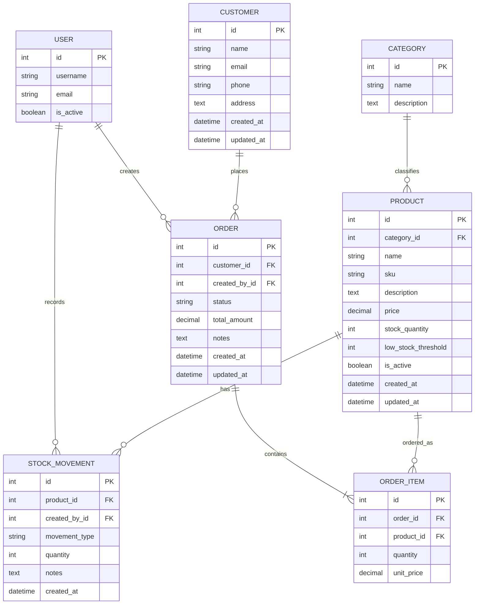

# Smart Inventory — Entity Relationship Diagram

**Status: proposed documentation diagram.** The relationships and major fields are based on earlier Django model definitions. Verify the actual `models.py` files and migrated database schema before treating this as a precise physical ERD for assessment.

## Entity relationship diagram (Mermaid)

GitHub supports Mermaid diagrams in Markdown.



The companion [ER_DIAGRAM.png](ER_DIAGRAM.png) provides a shareable image export of the same **conceptual** model.

## Relationship rules

| Parent | Child | Cardinality | Business meaning |
|---|---|---|---|
| Category | Product | 1:N | Each product belongs to a category |
| Product | StockMovement | 1:N | A product has a chronological stock adjustment record |
| Customer | Order | 1:N | A customer can have multiple orders |
| Order | OrderItem | 1:N | Each order contains one or more line items |
| Product | OrderItem | 1:N | A product can appear in many order lines |
| User | Order | 1:N | Order creator is recorded |
| User | StockMovement | 1:N | Staff member initiating a movement can be recorded |

## Inventory / order behavior

1. **Stock-in:** validate a positive quantity, increase the product's stock, and create an audit movement.
2. **Stock-out:** reject requests larger than available stock, decrease quantity and create a movement.
3. **Order creation:** save the order and line items, calculate totals, and deduct product stock atomically.
4. **Order cancellation:** update the order status and restore stock once; guard against repeated cancellation.
5. **Low-stock alerts:** flag products whose `stock_quantity` meets the application's configured threshold rule.

## Important schema clarifications

- `USER` represents Django's configured authentication model; actual table name may be `auth_user` or a custom model.
- The `subtotal` of an order item was described earlier as a **computed property** (`quantity × unit_price`); it is intentionally not shown as a persisted column.
- The exact schema may also include `cost_price`, address metadata, role fields, or different movement-model names. They must be included **only after checking current models**.
- `created_by` may be nullable and category/product delete behavior depends on the actual Django foreign-key definitions.
- The conceptual diagram intentionally omits Django auth, permissions, migration, and session tables for readability.

## Verify the physical schema safely

Review the current model definitions before uploading this diagram:

```powershell
cd "C:\Users\pro\OneDrive\Desktop\Smart_Inventory_System\backend"
Get-ChildItem -Path . -Recurse -Filter models.py -File |
    Where-Object { $_.FullName -notmatch '[\\/](venv|\.venv|node_modules)[\\/]' } |
    Select-Object -ExpandProperty FullName
```

Compare the Mermaid fields with `products/models.py`, `inventory/models.py`, `customers/models.py`, `orders/models.py` and the configured user model. This command is read-only.
