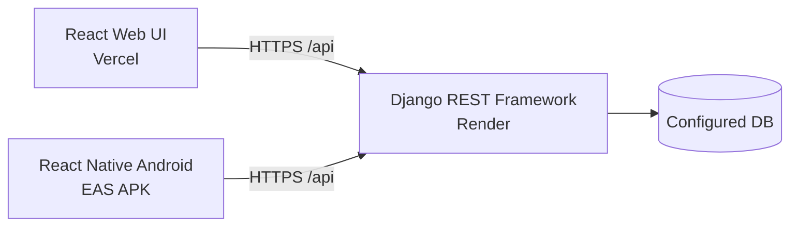

# Smart Inventory — Project Structure & Architecture

> This is a **documentation-oriented outline**, assembled from previously observed directories and modules. It is not a verified exhaustive listing of every file. Check the current repository tree before representing it as exact.

## High-level structure

```text
Smart_Inventory_System/
├── backend/                      # Django REST Framework backend
│   ├── config/                   # Project settings, root URL routes
│   ├── accounts/                 # Authentication / user-related module (verify)
│   ├── products/                 # Categories and products
│   ├── inventory/                # Stock adjustments and movement history
│   ├── customers/                # Customer management
│   ├── orders/                   # Orders, items, stock-deduction services
│   ├── reports/                  # Reports endpoints (verify exact contents)
│   ├── manage.py                 # Django administration entry point
│   └── requirements.txt          # If present: Python dependency manifest
├── frontend/                     # React + Vite web dashboard
│   ├── src/
│   │   ├── assets/
│   │   ├── components/
│   │   ├── context/
│   │   ├── layouts/
│   │   ├── pages/
│   │   ├── services/
│   │   │   └── api.js            # VITE_API_URL / Axios client
│   │   ├── App.jsx
│   │   ├── App.css
│   │   ├── main.jsx
│   │   └── index.css
│   ├── package.json
│   ├── vercel.json                # SPA routing configuration
│   └── .env.production           # Local production build configuration
├── mobile app/                   # React Native / Expo Android client
│   ├── src/
│   │   ├── app/                  # Expo Router route files
│   │   ├── components/
│   │   ├── constants/
│   │   ├── hooks/
│   │   ├── screens/
│   │   ├── services/             # Production API client(s)
│   │   ├── types/
│   │   └── global.css
│   ├── assets/
│   ├── app.json                  # Expo app name, Android package ID
│   ├── eas.json                  # EAS preview APK profile
│   ├── package.json
│   └── tsconfig.json
├── README.md                      # Main overview and setup instructions
├── ER_DIAGRAM.md                  # Editable Mermaid database ERD
├── ER_DIAGRAM.png                 # Conceptual diagram image
└── PROJECT_STRUCTURE.md          # This file
```

### Notes on generated/local files

- `frontend/dist/` is the Vite build output, not hand-written source.
- `node_modules/`, Python virtual environments and Expo temporary caches are generated dependencies.
- `.env.local`, passwords, `VERCEL_OIDC_TOKEN`, JWTs, and MySQL credentials must **not** be committed.
- Android APKs and EAS build artifacts should be distributed via controlled download links rather than checked into source by default.

## How the components communicate



The development backend has used a local MySQL database named `smart_inventory_db`. The deployed database service must be checked independently.

## Module responsibilities

| Module / directory | Responsibilities |
|---|---|
| `backend/config` | Django settings, project URLs, integration configuration |
| `backend/products` | Category and product CRUD, search |
| `backend/inventory` | Stock-in/out validation, audit movements, low-stock endpoint |
| `backend/customers` | Customer records and search |
| `backend/orders` | Order creation, totals, order items, stock updates, cancellation |
| `backend/reports` | Sales/inventory reporting endpoints, where implemented |
| `frontend/src/pages` | Web-facing screens |
| `frontend/src/services/api.js` | Backend base URL and HTTP client |
| `mobile app/src/app` | Expo Router navigation |
| `mobile app/src/screens` | Android-facing views |
| `mobile app/src/services` | Mobile API integration |

## Capture the exact local project tree (read-only)

Run from PowerShell; the output excludes generated dependency folders to keep it reviewable:

```powershell
$root = "C:\Users\pro\OneDrive\Desktop\Smart_Inventory_System"
Get-ChildItem -LiteralPath $root -Recurse -Force -File |
  Where-Object {
    $_.FullName -notmatch '[\\/](node_modules|venv|\.venv|\.git|\.expo|dist|__pycache__)[\\/]'
  } |
  ForEach-Object { $_.FullName.Substring($root.Length + 1) } |
  Select-Object -First 300
```

For the repository URL:

```powershell
Set-Location "C:\Users\pro\OneDrive\Desktop\Smart_Inventory_System"
git remote -v
```

Inspect the output before sharing; exclude any local files that might contain secrets. If the repository has a different root or file structure, revise this document accordingly.
