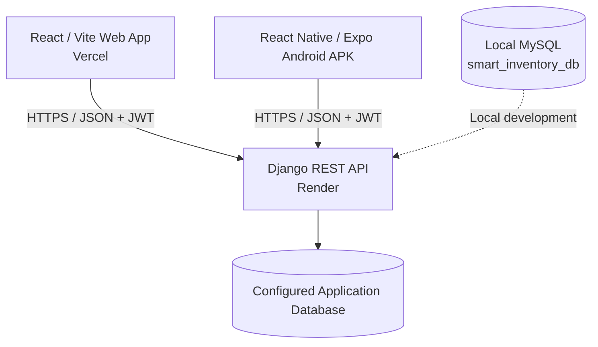

# Smart Inventory & Order Management System

A full-stack inventory and order management application with a responsive React web dashboard, a standalone Android app built with Expo/React Native, and a shared Django REST API.

> **Documentation status:** Prepared for the internship assessment using tested application workflows and previously defined Django models. Before publishing, validate the [database model diagram](ER_DIAGRAM.md) and [repository layout](PROJECT_STRUCTURE.md) against the latest source code. In particular, confirm the production database configuration and any role-based access enforcement.

## Live deliverables

| Component | URL / status |
|---|---|
| Web application | [Smart Inventory on Vercel](https://smart-inventory-system-eta.vercel.app) |
| REST API | [Render API base](https://smart-inventory-api-pin2.onrender.com/api/) |
| Android APK | [Expo EAS preview build](https://expo.dev/accounts/answaff/projects/mobile-react-native/builds/6b70b8bc-3aa9-4d55-b8c4-a3560f6167ae) |
| API documentation | Verify the deployed Swagger URL (commonly `/api/docs/`) before adding a public link |
| ER diagram | [ER_DIAGRAM.md](ER_DIAGRAM.md) and [ER_DIAGRAM.png](ER_DIAGRAM.png) |
| Project structure | [PROJECT_STRUCTURE.md](PROJECT_STRUCTURE.md) |

The Expo build is an **internal-distribution Android APK**, not a Google Play release. The build link may require appropriate Expo access; for evaluators, provide a separately shareable APK if necessary.

## Project objectives

Provide a single inventory workflow across web and Android clients: catalog management, stock visibility and adjustments, customer records, order processing, and audit history via a central authenticated API.

## Features

| Module | Functionality |
|---|---|
| Authentication | JWT login and token refresh |
| Dashboard | Summary of products, stock, orders and sales |
| Products | Create, view, update, delete and search products; category association |
| Inventory | Stock-in and stock-out with quantity validation; inventory movement history and low-stock alerts |
| Customers | Manage customer records and search |
| Orders | Create orders with items, deduct stock, view history/details, cancel with stock restoration |
| Reports | Sales and inventory reporting area; confirm each production report endpoint before claiming coverage |

**Verification scope:** The published Android APK was tested for launch, login, products, inventory history, low-stock alerts, customers, order history and order details. The deployed website was tested for login, dashboard and refresh, and its compiled assets include the Render API URL. These checks do **not** constitute complete write-operation, role-permission, offline or security testing.

## Technology stack

| Layer | Technology |
|---|---|
| Web frontend | React, JavaScript, Vite |
| Android | React Native, Expo SDK 58, Expo Router, TypeScript |
| Backend | Python, Django, Django REST Framework |
| Authentication | JWT (Simple JWT) |
| Database | MySQL for local development; confirm the production database connection in Render settings |
| Web hosting | Vercel |
| API hosting | Render |
| Android builds | Expo Application Services (EAS) |

## Architecture



The diagram distinguishes local MySQL from the database configured for the deployed Render service. Do not assume both environments share records.

## API overview

Base URL: `https://smart-inventory-api-pin2.onrender.com/api/`

| HTTP method | Endpoint | Purpose |
|---|---|---|
| `POST` | `token/` | Obtain access and refresh tokens |
| `POST` | `token/refresh/` | Refresh access token |
| `GET`, `POST` | `products/` | List/create products |
| `GET`, `PATCH`, `DELETE` | `products/{id}/` | Product details/update/delete |
| `POST` | `inventory/stock-in/` | Increase stock |
| `POST` | `inventory/stock-out/` | Decrease stock |
| `GET` | `inventory/movements/` | Inventory audit trail |
| `GET` | `inventory/low-stock/` | Low-stock products |
| `GET`, `POST` | `customers/` | List/create customers |
| `GET`, `PATCH`, `DELETE` | `customers/{id}/` | Customer details/update/delete |
| `GET`, `POST` | `orders/` | Order history/create order |
| `GET` | `orders/{id}/` | Order details |
| `POST` | `orders/{id}/cancel/` | Cancel order and restore stock |

Protected routes require `Authorization: Bearer <access-token>`. These paths reflect tested development workflows; check deployed API documentation for final details.

## Getting started locally (Windows / PowerShell)

### Prerequisites

- Python, Node.js/npm and MySQL Server
- A local MySQL database named `smart_inventory_db` (or your chosen configured database)
- Backend dependencies defined by the repository's dependency manifest
- Android phone with Expo Go for development, or the release APK for standalone testing

### Backend

```powershell
cd backend
python -m venv venv
.\venv\Scripts\Activate.ps1
# Install dependencies from the backend's actual requirements file, if present:
pip install -r requirements.txt
# Configure Django secret key, DB credentials, allowed hosts and CORS locally.
python manage.py migrate
python manage.py runserver
```

**Before running:** check that `backend/requirements.txt` exists and configure Django's database settings using the environment names expected by `backend/config/settings.py`. Do not commit local credentials. `migrate` changes the configured database and should be used only in a correctly configured development environment.

### Web frontend

```powershell
cd frontend
npm ci
# For production builds, set VITE_API_URL=https://smart-inventory-api-pin2.onrender.com/api
npm run dev
# Production build:
npm run build
```

`frontend/src/services/api.js` uses `import.meta.env.VITE_API_URL` and otherwise falls back to `http://127.0.0.1:8000/api`. Use a local `.env.local` for development or a production environment variable in Vercel. Avoid committing real `.env` files or credentials.

### Android app (Expo)

```powershell
cd 'mobile app'
npm ci
npx expo start --go
# EAS internal-distribution APK build (requires an authenticated Expo account):
eas build --platform android --profile preview
```

The Android app uses `EXPO_PUBLIC_API_URL` for its API base URL. The existing `preview` EAS profile specifies the Render API. Do not put credentials in public frontend/mobile environment variables.

## Documentation

- [Database relationships and Mermaid ER diagram](ER_DIAGRAM.md)
- [Project folder structure and responsibilities](PROJECT_STRUCTURE.md)

## Security / testing notes

- Never publish login passwords, JWT tokens, MySQL credentials, `.env.local`, or Vercel OIDC tokens.
- Use a dedicated, limited-permission test account; share its credentials privately with the evaluator.
- Verify permissions on the production API before claiming role-based authorization.
- Evaluate write operations using disposable test data in an authorized test environment; creating and canceling orders affects stock.
- Keep the Expo preview APK separate from any signed Play Store release.

## Author

**Answaf KP** — [GitHub profile](https://github.com/answaff) · [LinkedIn](https://www.linkedin.com/in/answaf-kp-9b4a69319)

> Add the confirmed **repository URL**, **API documentation URL**, **demo-video links** and any **evaluation instructions** to this README once verified. No evaluator password should be stored here.
